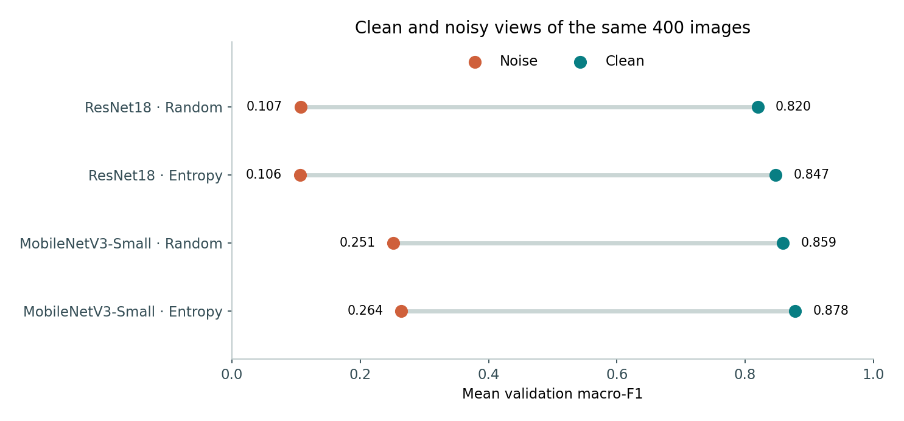
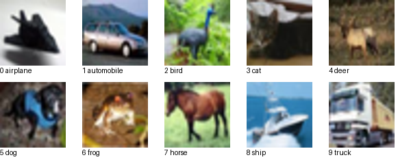
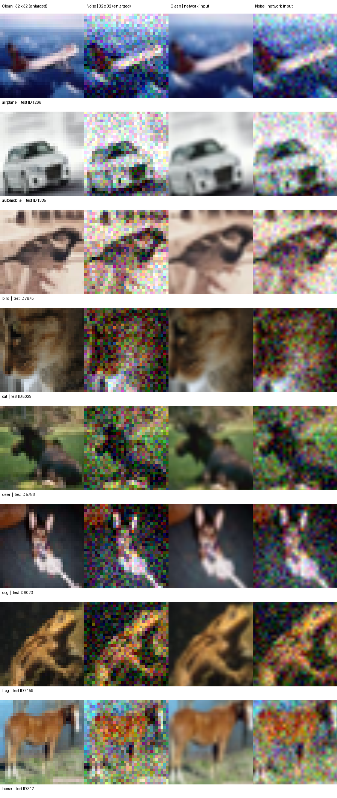
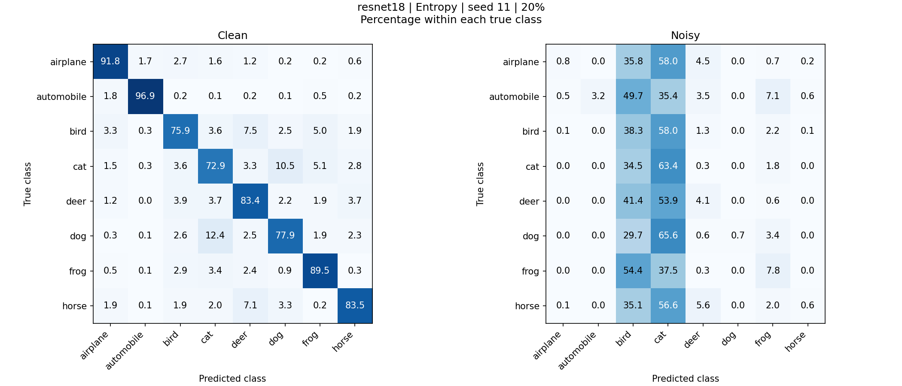
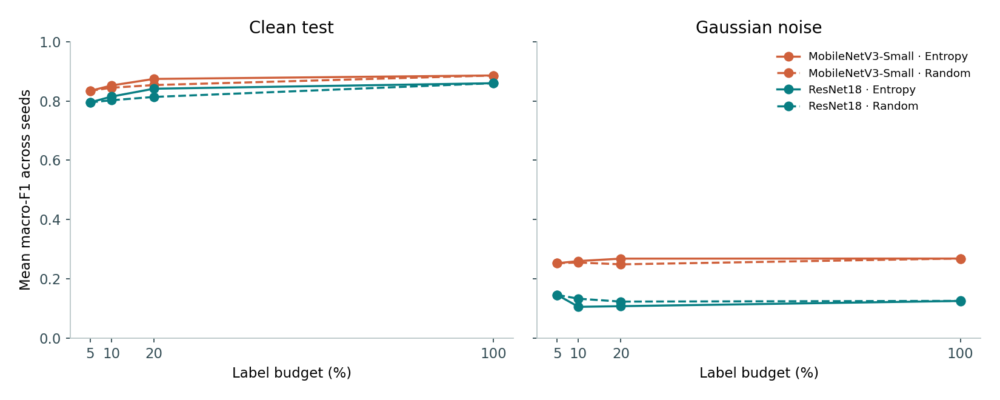

# Data-Efficient Vision Under Shift

**Active learning with frozen image encoders on CIFAR-10**

[Results](#validation-results) · [Dataset](#dataset-and-label-budgets) · [Error analysis](#class-level-error-audit) · [Run in PyCharm](#reproduce-in-pycharm) · [Figures](#figure-gallery)

*20% label budget · 7,600 training labels · 400 validation images · five acquisition seeds*

## Overview

Does labeling the images a classifier finds most uncertain improve recognition when the same images are corrupted by noise? This project compares entropy sampling with random sampling on eight CIFAR-10 classes. Both methods use frozen ImageNet-1K V1 features and a logistic regression head (C = 1). Only the choice of training examples changes within each paired comparison.

At a 20% total label budget, entropy sampling improved clean validation macro-F1 by 2.78 percentage points for ResNet18 and 1.88 for MobileNetV3-Small. Under Gaussian noise the corresponding differences were −0.09 and +1.26 points. The results below include the variation across training seeds.

## Dataset and label budgets

CIFAR-10 contains 60,000 RGB images of 32 × 32 pixels. The original split contains 50,000 training images and 10,000 test images. This project defines an eight-class downstream task using the original split.

| Partition | Classes | Images | Use |
|---|---|---:|---|
| Known training pool | Airplane, automobile, bird, cat, deer, dog, frog, horse | 40,000 | Simulate purchasing labels and fit the classifier |
| Known clean test | Same eight classes | 8,000 | Measure classification and confidence |
| Known noisy test | Same eight classes and image IDs | 8,000 paired views | Measure sensitivity to Gaussian noise |
| Unknown test | Ship and truck | 2,000 | Evaluate semantic out-of-distribution (OOD) detection |

The 10,000 training photographs of ships and trucks are excluded. The noisy test set reuses the clean test photographs. Noise is added at the original resolution with standard deviation 0.12 on a 0–1 pixel scale, then clipped to that range. A seed derived from the image index gives every model the same noisy view.

| Label budget | 5% | 10% | 20% | 100% |
|---|---:|---:|---:|---:|
| Total revealed labels | 2,000 | 4,000 | 8,000 | 40,000 |
| Training labels in the exploratory benchmark | 2,000 | 4,000 | 8,000 | 40,000 |
| Training labels under protocol v1 | 1,600 | 3,600 | 7,600 | 39,600 |
| Validation labels under protocol v1 | 400 | 400 | 400 | 400 |

Dataset source and class definitions: [CIFAR-10, University of Toronto](https://www.cs.toronto.edu/~kriz/cifar.html).

## Validation results

Run `validation_baselines_20261120_024839_285519` used the same 400 validation images for all fits. Each seed starts from a shared set of 1,600 labels. Random extends a fixed permutation. Entropy ranks the remaining clean pool images using the previous head's predictive entropy. Both methods acquire 2,000 additional labels at the 10% round and another 4,000 at 20%. Each encoder has one full-pool reference fit.

### Macro-F1 at 20% total labels

| Encoder | Selection | Clean validation | Noisy validation | Clean ECE | Noisy ECE |
|---|---|---:|---:|---:|---:|
| ResNet18 | Random | 0.8195 | 0.1067 | 0.1126 | 0.6664 |
| ResNet18 | Entropy | 0.8474 | 0.1058 | 0.0865 | 0.6300 |
| MobileNetV3-Small | Random | 0.8591 | 0.2514 | 0.0554 | 0.3968 |
| MobileNetV3-Small | Entropy | 0.8779 | 0.2641 | 0.0511 | 0.3901 |

Entries are five-seed means. Lower ECE indicates better agreement between confidence and accuracy. MobileNetV3-Small with Entropy had the highest noisy macro-F1 of the four configurations, but even this classifier averaged only 30.75% accuracy on noisy images, versus 88.30% on their clean counterparts.

### Paired effect of entropy sampling

Each difference is 100 × (Entropy macro-F1 − Random macro-F1) for the same encoder, budget, seed and validation images. The table gives the mean ± sample standard deviation in percentage points. Wins count seeds with a positive difference.

| Encoder | Total labels | Clean difference | Clean wins | Noisy difference | Noisy wins |
|---|---:|---:|---:|---:|---:|
| ResNet18 | 10% | +1.94 ± 2.31 | 4/5 | +1.44 ± 4.72 | 3/5 |
| ResNet18 | 20% | +2.78 ± 2.62 | 4/5 | −0.09 ± 5.55 | 2/5 |
| MobileNetV3-Small | 10% | +1.71 ± 1.26 | 5/5 | +0.76 ± 4.42 | 2/5 |
| MobileNetV3-Small | 20% | +1.88 ± 0.81 | 5/5 | +1.26 ± 2.05 | 3/5 |

For ResNet18 at 20%, the noisy differences ranged from −8.15 to +6.86 points. The near-zero mean hides substantial seed variation. MobileNetV3-Small gained on clean images in every paired comparison, while its noisy 20% differences ranged from −0.93 to +3.58 points. More clean labels alone also left a large gap. With all 39,600 available training labels, clean/noisy macro-F1 was 0.8604/0.1326 for ResNet18 and 0.8982/0.2539 for MobileNetV3-Small.

The archive contains 52 fits and 104 clean/noisy metric rows. Accuracy, macro-F1 and 10-bin ECE were recomputed from the prediction files. All 40 paired differences and eight summaries matched the CSV exports. Every saved training subset was disjoint from the validation IDs. All fits used L-BFGS without a recorded convergence warning.

### Fixed split

Script 09 implements the [evaluation protocol](evaluation_protocol.md). The saved split in `results/validation_split_v1/` contains 400 validation IDs and 39,600 acquisition-pool IDs. The arrays are disjoint and together match the 40,000 original CIFAR-10 training IDs from the 100% ResNet18 baseline. Replaying PCG64 with seed 20261120 on those sorted baseline IDs reproduced both arrays exactly. Both file hashes matched `split_summary.json`.

The recorded validation counts are airplane 54, automobile 52, bird 51, cat 47, deer 49, dog 41, frog 62 and horse 44. Under this protocol the 400 validation labels count toward every budget. At 20%, the classifier therefore receives 7,600 training labels. Earlier benchmark tables use the original budget convention.

## Exploratory test benchmark

### First baseline

1. Randomly select 2,000 known-class training images using seed 11.
2. Load the ImageNet-1K pretrained ResNet18, remove its final classification layer, and apply the preprocessing supplied with the weights.
3. Extract features on the GPU with the encoder frozen. Fit a logistic regression classifier on the CPU using the selected labels.
4. Measure accuracy and macro-F1 twice, first on clean test images and then on their noisy counterparts. Save the scores and selected training IDs.

### First run · ResNet18 · 2,000 labels · seed 11

| Test condition | Images | Accuracy | Macro-F1 |
|---|---:|---:|---:|
| Clean | 8,000 | 0.786500 | 0.786832 |
| Gaussian noise | 8,000 | 0.220125 | 0.146720 |

Run `baseline_20261119_220732_930634`. Adding noise reduced macro-F1 by 64.01 percentage points and accuracy by 56.64 points. These figures come from script 02. The corresponding fit in script 03 used the same selected IDs and produced slightly different scores.

### Reproducibility check

The ResNet18 random-sampling run at 20% labels (8,000 training IDs, seed 11) was replayed on the same RTX 5070 Laptop GPU. The archived ID file matched its SHA-256 digest. Both fits used ImageNet-1K V1 weights and took 1,103 L-BFGS iterations.

| Evaluation | Metric | Original | Replay |
|---|---|---:|---:|
| Clean | Accuracy | 0.807625 | 0.807625 |
| Clean | Macro-F1 | 0.807645 | 0.807645 |
| Gaussian noise | Accuracy | 0.187125 | 0.187125 |
| Gaussian noise | Macro-F1 | 0.123015 | 0.123015 |

Across all 12 classification, calibration and OOD metrics, nine differences were exactly zero and the largest absolute difference was 8.33 × 10⁻¹⁷. This verifies aggregate-score repeatability for this configuration on the recorded setup. Original run: `comparison_20261119_225145_293414`. Replay: `replay_resnet18_20261120_014546_964948`. Run `04.reproduce_resnet18_baseline.py` in PyCharm to generate `comparison.csv` and `replay_details.json`.

### Image pipeline audit

Run `pipeline_20261120_015510_030291` checked all 8,000 unique known-class test images (1,000 per class). With noise amplitude set to zero, the audit path reproduced both the clean RGB values and the normalized ResNet18 input tensors exactly. At σ = 0.12, the audit reconstruction matched the project noise function on every RGB value.

| Measurement at σ = 0.12 | Result |
|---|---:|
| Mean absolute change per RGB channel value, 0–1 scale | 0.09108 |
| Equivalent mean change on the 0–255 scale | 23.23 |
| Channel values outside [0, 1] before clipping | 1,545,225 / 24,576,000 (6.29%) |

The preview pairs clean and noisy views before and after preprocessing for one image per class. These checks verify the implemented perturbation. The next two tables trace the drop to individual predictions and classes.

### Paired image predictions

Export `image_predictions_20261120_021017_526692` contains the same 8,000 labeled test IDs in each of four configurations (seed 11, 20% labels). All 16 accuracy and macro-F1 checks matched the archived benchmark to within 1e-8. The transition counts below compare each image with its own corrupted view.

| Encoder | Policy | Clean macro-F1 | Noisy macro-F1 | Correct to wrong | Wrong to correct |
|---|---|---:|---:|---:|---:|
| ResNet18 | Random | 0.8076 | 0.1230 | 5,303 | 339 |
| ResNet18 | Entropy | 0.8395 | 0.0898 | 5,812 | 283 |
| MobileNetV3-Small | Random | 0.8482 | 0.2323 | 4,765 | 215 |
| MobileNetV3-Small | Entropy | 0.8744 | 0.2666 | 4,734 | 192 |

With entropy acquisition, ResNet18 predicted cat or bird for 7,473 of 8,000 noisy images (93.41%), although those two classes accounted for 2,000 images (25%). For example, it labeled 656 of the 1,000 noisy dog images as cats. These counts describe one seed and corruption level.

### Class-level error audit

Run `prediction_errors_20261120_022343_139274` covers seed 11 at the 20% budget. All eight clean/noisy confusion matrices were reconstructed from the image-level export. Automobile had the largest clean-to-noisy class F1 drop in each configuration.

| Encoder | Policy | Clean automobile F1 | Noisy automobile F1 | Correct out of 1,000 noisy cars | Most frequent wrong label (count) |
|---|---|---:|---:|---:|---|
| ResNet18 | Random | 0.9648 | 0.0714 | 37 | Deer (334) |
| ResNet18 | Entropy | 0.9714 | 0.0620 | 32 | Bird (497) |
| MobileNetV3-Small | Random | 0.9723 | 0.0768 | 40 | Frog (530) |
| MobileNetV3-Small | Entropy | 0.9733 | 0.1043 | 55 | Frog (501) |

For ResNet18 with entropy sampling, automobile contributed 11.37 percentage points to the total 74.97-point macro-F1 drop (class F1 drop divided by eight). These class-level counts are specific to one seed and one noise level.

### Model and budget comparison

Both acquisition policies start with the same randomly selected 5% for a given seed. At the next budget, **Random** continues along a fixed random ordering. **Entropy** ranks the remaining images by uncertainty under the previous classifier, reveals labels for the highest-ranked images and refits the head. At 100%, both policies have access to the entire pool. The intermediate 10% and 20% budgets reveal where the acquisition policy makes a difference.

Values at 20% labels are means ± sample standard deviations across seeds 11, 22, 33, 44 and 55. Run `comparison_20261119_225145_293414` contains all 80 fitted configurations and 160 domain rows. Every recorded fit used lbfgs (211–1,654 iterations).

| Encoder | Selection | Clean macro-F1 ↑ | Noisy macro-F1 ↑ | Noisy Brier ↓ | MSP AUROC ↑ |
|---|---|---:|---:|---:|---:|
| ResNet18 | Random | 0.8138 ± 0.0035 | 0.1228 ± 0.0259 | 1.3728 ± 0.1197 | 0.5574 ± 0.0242 |
| ResNet18 | Entropy | 0.8415 ± 0.0031 | 0.1073 ± 0.0106 | 1.3771 ± 0.0369 | 0.5176 ± 0.0150 |
| MobileNetV3-Small | Random | 0.8539 ± 0.0048 | 0.2486 ± 0.0152 | 1.0404 ± 0.0341 | 0.5686 ± 0.0266 |
| MobileNetV3-Small | Entropy | 0.8746 ± 0.0016 | 0.2679 ± 0.0135 | 1.0182 ± 0.0251 | 0.5723 ± 0.0076 |

#### Effect of entropy selection

For each encoder, budget and test condition, we subtracted Random macro-F1 from Entropy macro-F1 within each seed. Values are mean differences in percentage points ± sample standard deviation. Wins count seeds where Entropy scored higher.

| Encoder | Labels | Clean | Clean wins | Gaussian noise | Noise wins |
|---|---:|---:|---:|---:|---:|
| ResNet18 | 10% | +1.24 ± 0.24 | 5/5 | −2.74 ± 1.88 | 0/5 |
| ResNet18 | 20% | +2.77 ± 0.33 | 5/5 | −1.55 ± 2.45 | 1/5 |
| MobileNetV3-Small | 10% | +0.76 ± 0.33 | 5/5 | +0.50 ± 4.62 | 3/5 |
| MobileNetV3-Small | 20% | +2.07 ± 0.59 | 5/5 | +1.93 ± 1.28 | 5/5 |

Run `paired_results_20261120_022844_500509` reproduces all 40 differences from `comparison_20261119_225145_293414/metrics.csv`. For MobileNetV3-Small at 10% under noise, differences ranged from −5.40 to +7.51 points across seeds. The seeds vary training selection on one fixed test set and one noise setting.

<b>How to read the comparison CSV</b>

| Columns in metrics.csv | Interpretation |
|---|---|
| acc, f1 | Accuracy and macro-F1 on the indicated domain. Macro-F1 gives each known class equal weight. |
| ece, brier | Top-label calibration error in 10 equal-width confidence bins, and multiclass Brier score summed across classes. Lower values are better. |
| msp_auc, msp_fpr95 | OOD detection using one minus the largest predicted class probability. An unknown image is the positive class. FPR95 is the fraction of known images flagged as unknown at the first ROC point with at least 95% unknown detection. |
| energy_auc, energy_fpr95 | The same detection task scored using negative log-sum-exp of the head logits. |
| median_ms | Median synchronized forward time on one preprocessed image, including the GPU head, over 50 calls after 10 warm-up calls. |
| weights_buffers_mib, gpu_peak_mib | Parameter and buffer storage, and peak allocated GPU memory during the timed inference section. |

For the comparison script the noisy domain is named `noise`; the first baseline uses `noisy`. OOD metrics compare **clean known** with **unknown** images and repeat on both domain rows. Use one row per seed/configuration when summarizing OOD and runtime.

## Figure gallery

Each experiment writes its figures to `assets/<script name>/<run ID>/`. The folder name matches the Python filename without its `.py` extension. Each timestamped run keeps its own figures. Script 09 reuses the fixed split name when verifying the same split. The gallery links to the runs reported here.

| Script | Recorded figure |
|---|---|
| `01.explore_cifar10.py` | [CIFAR-10 examples](assets/01.explore_cifar10/recorded/cifar10_examples.png) |
| `02.run_first_baseline.py` | [Accuracy and macro-F1](assets/02.run_first_baseline/baseline_20261119_220732_930634/baseline.png) |
| `03.compare_models_and_budgets.py` | [Label-budget curves](assets/03.compare_models_and_budgets/comparison_20261119_225145_293414/budget_curves.png) |
| `05.inspect_image_pipeline.py` | [Clean and noisy image pairs](assets/05.inspect_image_pipeline/pipeline_20261120_015510_030291/clean_vs_noisy.png) |
| `06.export_image_predictions.py` | [Correctness transitions](assets/06.export_image_predictions/image_predictions_20261120_021017_526692/transitions.png) |
| `07.analyze_prediction_errors.py` | [Four pairs of confusion matrices](assets/07.analyze_prediction_errors/prediction_errors_20261120_022343_139274) |
| `08.summarize_paired_results.py` | [Paired seed differences](assets/08.summarize_paired_results/paired_results_20261120_022844_500509/paired_differences.png) |
| `09.prepare_validation_split.py` | [Validation class counts](assets/09.prepare_validation_split/validation_split_v1/validation_classes.png) |
| `10.run_validation_baselines.py` | [Clean and noisy validation macro-F1](assets/10.run_validation_baselines/validation_baselines_20261120_024839_285519/validation_macro_f1.png) |

## Reproduce in PyCharm

Open the repository folder in PyCharm and choose a Python interpreter with CUDA-enabled PyTorch and compatible torchvision. The scripts also use NumPy, pandas, SciPy, scikit-learn, Pillow and Matplotlib. The recorded comparison ran on an NVIDIA GeForce RTX 5070 Laptop GPU with CUDA 12.8. Dataset and pretrained-weight downloads require internet access on first use.

Right-click the desired file in the Project panel and choose **Run**. Experiment settings are ordinary Python variables near the top of each experiment file.

| File | Purpose | Output |
|---|---|---|
| 00.check_gpu.py | Check the interpreter, CUDA and GPU computation | GPU name and test calculation in the Run window |
| 01.explore_cifar10.py | Inspect the dataset and display one example per class | cifar10_examples.png and class counts |
| 02.run_first_baseline.py | Run the first clean/noisy comparison | results/baseline_&lt;timestamp&gt;/baseline_scores.csv and selected_train_ids.npy |
| 03.compare_models_and_budgets.py | Compare two encoders, two selection policies and four budgets | results/comparison_&lt;timestamp&gt;/metrics.csv, training-ID files and environment.json |
| 04.reproduce_resnet18_baseline.py | Replay the saved 20% ResNet18 selection | Metric-by-metric comparison |
| 05.inspect_image_pipeline.py | Check paired preprocessing and noise | Image previews and pixel audit |
| 06.export_image_predictions.py | Export paired test predictions at seed 11 and 20% labels | Per-image labels, predictions and probabilities |
| 07.analyze_prediction_errors.py | Identify class confusions under noise | Confusion matrices and class-level error summaries |
| 08.summarize_paired_results.py | Compare Entropy and Random within each seed using the saved comparison CSV | paired_by_seed.csv, paired_summary.csv and paired_differences.png |
| 09.prepare_validation_split.py | Create or verify the shared validation and acquisition IDs | results/validation_split_v1/ |
| 10.run_validation_baselines.py | Fit Random, Entropy and the full-pool references on the split from script 09 | Validation metrics, paired summaries, predictions, selected IDs and run details |

For the historical replay and analysis scripts (04, 06, 07 and 08), set the source run at the top of the script to the matching archived output in `results/`. Script 04 verifies the original selection hash and needs the matching historical run.

For the validation experiment, use script 01 or 02 to download CIFAR-10 into `data/` if needed. Run 09 once to save the split, then run 10. Open `paired_summary.csv` in the new `results/validation_baselines_<timestamp>/` folder. Its mean, standard deviation and range columns use percentage points. The original per-seed macro-F1 values in `paired_by_seed.csv` use the 0–1 scale.

The validation run used Python 3.12.12, PyTorch 2.12.0.dev20260408+cu128, torchvision 0.27.0.dev20260407+cu128, NumPy 2.5.5 and scikit-learn 1.8.0 on Windows 11. Script 10 uses the GPU for feature extraction and the CPU for the logistic regression fits.

### Repository layout

| Path | Role |
|---|---|
| data/ | Local CIFAR-10 download shared by the experiment scripts |
| cifar10_data.py | Dataset paths and train/test loading |
| gpu_check.py | Shared CUDA check |
| image_features.py | Encoder loading, feature extraction and deterministic image corruption |
| evaluation_metrics.py | Classification, calibration and OOD metrics |
| results/ | Generated run folders |
| assets/ | Figures grouped by script and run |
| figure_assets.py | Plotting and image export functions shared by the numbered scripts |

## Interpretation and limitations

The 400 validation images come from the training partition. Scripts 02–08 examined the official test partition earlier in development. The two experiments differ in evaluation images and classifier training budgets, so differences between their estimates cannot be attributed to a single change. For example, at 20% the mean noisy ResNet18 difference was −1.55 points in the exploratory test run and −0.09 points in validation.

All five acquisition seeds share the same images and the same noise realization. Their spread measures sensitivity to training selection. Results cover one Gaussian noise level and two supervised pretrained encoders. Blur, natural distribution shifts and external datasets require separate evaluation. The OOD experiment holds ship and truck out of the downstream classifier; ImageNet pretraining may include related categories.

## References

- Krizhevsky, Nair and Hinton. [CIFAR-10 dataset](https://www.cs.toronto.edu/~kriz/cifar.html).
- Ash et al. [Deep Batch Active Learning by Diverse, Uncertain Gradient Lower Bounds](https://arxiv.org/abs/1906.03671). ICLR 2020.
- Guo et al. [On Calibration of Modern Neural Networks](https://proceedings.mlr.press/v70/guo17a.html). ICML 2017.
- Liu et al. [Energy-based Out-of-distribution Detection](https://proceedings.neurips.cc/paper/2020/hash/f5496252609c43eb8a3d147ab9b9c006-Abstract.html). NeurIPS 2020.

## Maintainer

[Mehdi Hashemi](https://github.com/mehdi-hashemi-01)
